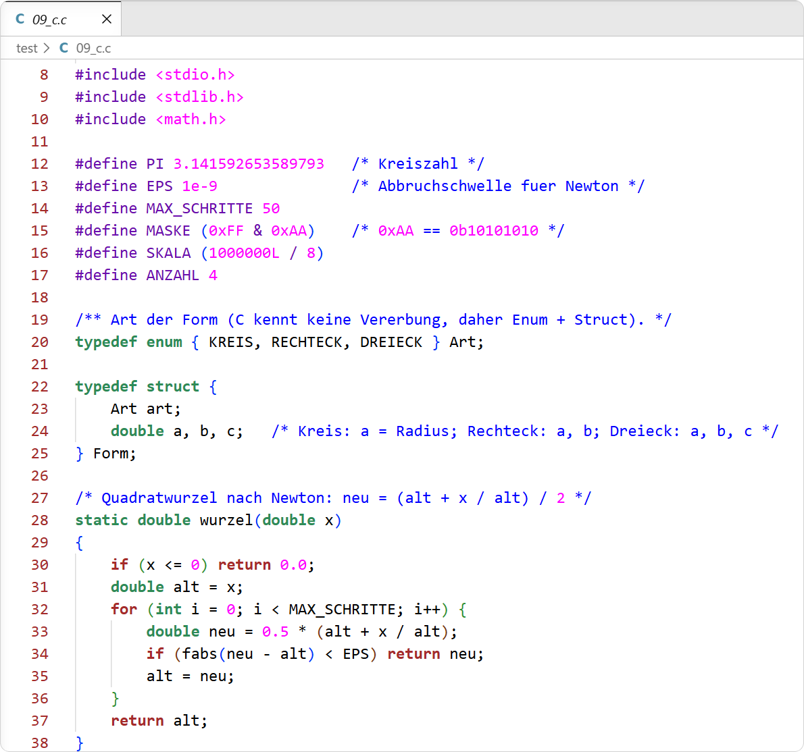
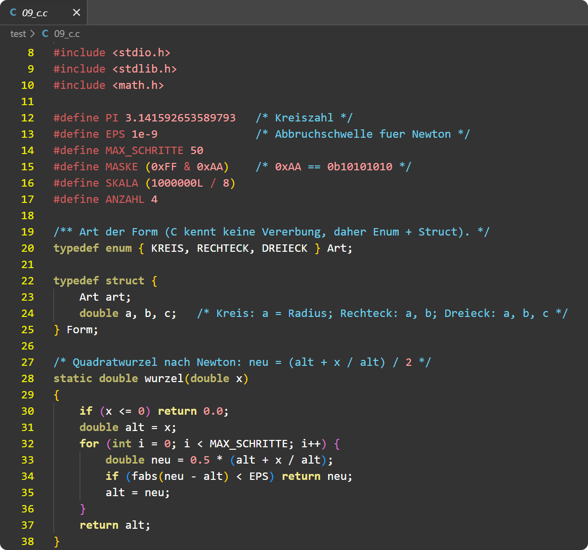

[English](README.md)

# VimSem

Die Farbschemata von Vim 9.2 als Themes für VS Code und VSCodium. Sie heissen
**"VimSem desert"**, **"VimSem elflord"** und so weiter (34 Themes). Auswählen kannst du eines
mit *Preferences: Color Theme*.

Die Farben stammen aus Vims Farbschemata, und der Code wird mit Vims eigenen Syntaxregeln
gefärbt. Ziel ist, dass eine Datei so aussieht, wie gVim sie mit den Grundeinstellungen zeigt
(ohne vimrc, ohne Plugins). **Vim muss nicht installiert sein.**





## Farben fehlen oder ändern sich nicht?

VimSem-Themes schalten Semantic Highlighting selbst ein, normalerweise musst du also nichts tun.

Bleibt dein Code ungefärbt, ist Semantic Highlighting vermutlich in deiner `settings.json`
ausgeschaltet, zum Beispiel weil du der Empfehlung der Extension "Vim Colorschemes" gefolgt
bist. Ändere die Zeile auf:

```json
"editor.semanticHighlighting.enabled": "configuredByTheme"
```

Ändern sich die Farben immer noch nicht, oder nach dem Aktualisieren oder Deinstallieren von
VimSem, beende den Editor und starte ihn neu. "Restart Extensions" reicht nicht immer.

## Themes

blue, catppuccin*, darkblue, default, delek, desert, elflord, evening, habamax, industry,
koehler, lunaperche*, morning, murphy, novum*, pablo, peachpuff, quiet*, retrobox*, ron,
shine, slate, sorbet, torte, unokai, wildcharm*, zaibatsu, zellner

\* hell und dunkel

## Sprachen

ABAP, Ada, Arduino, Assembly, AutoHotkey, AWK, BASIC, Batch, BibTeX, C, C#, C++, Clojure,
COBOL, CSS, CUDA, Cython, D, Dart, Diff, Dockerfile, Elm, Erlang, Forth, GDScript, GLSL, Go,
Groovy, Haskell, HTML, INI, Java, JavaScript, JSON, JSON mit Kommentaren, JSX, Julia, Kotlin,
LaTeX, Less, Lisp, Lua, Makefile, Markdown, MATLAB, Mojo, Nix, Nushell, Objective-C, OCaml,
Pascal, Perl, PHP, Plain TeX, PowerShell, Progress, Prolog, Python, R, Racket, Raku, Ruby,
Rust, SAS, Scala, Scheme, Scilab, SCSS, Shell (sh, bash, ksh), Smalltalk, Solidity, SQL,
Standard ML, Stata, Swift, SystemVerilog, Tcl, TOML, TSX, TypeScript, UnrealScript, Verilog,
VHDL, Visual Basic, XML, YAML, Zig

Für die Farben braucht es keine Spracherweiterungen. Wie in Vim entscheiden der Dateiname und
manchmal der Inhalt, welche Regeln gelten.

**Andere Dateien werden ohne Syntaxfarben angezeigt**, solange ein VimSem-Theme aktiv ist, zum
Beispiel Vue, Svelte, Fortran, Vim script, zsh, csh, ConTeXt, Sass (`.sass`), SVG, XSD, XSLT, JSON5 und
Konfigurationsdateien wie `.gitconfig`, `.editorconfig`, `*.cfg` oder `*.conf`. Manche
`*.conf` und ähnliche Dateien werden wie in Vim als INI oder TOML erkannt.

Auch Patches von `git format-patch` sind in Vim ein eigener Dateityp und werden nicht gefärbt.

## Oberfläche

Im Editor stammen die Farben aus Vims Farbschemata: Code, Text und Hintergrund,
Zeilennummern, Cursorzeile, Cursor, Auswahl und Suchtreffer.

Für Seitenleiste, Tabs und Statusleiste von VS Code gibt es in Vim nichts Vergleichbares. Jedes
Theme leitet diese Farben aus seinen eigenen Vim-Farben ab.

## Näher an Vim (freiwillig)

VimSem ändert keine deiner Einstellungen. Um näher an Vim zu kommen, kannst du diese Zeilen in
deine `settings.json` eintragen:

```json
"editor.bracketPairColorization.enabled": false,
"editor.occurrencesHighlight": "off",
"editor.selectionHighlight": false,
"editor.renderLineHighlight": "none"
```

Damit färbt VS Code Klammern nicht mehr nach Tiefe, markiert weder weitere Vorkommen des Wortes
unter dem Cursor noch des ausgewählten Texts und hebt die aktuelle Zeile nicht hervor. Die
Einstellungen gelten für alle Themes.

Nutzt du in Vim `set cursorline`, lass die letzte Zeile weg: Die Themes haben Vims Farbe für
die aktuelle Zeile schon. Ändern kannst du sie mit `editor.lineHighlightBackground` in
`workbench.colorCustomizations`.

## Settings

| Einstellung | Vorgabe | Bedeutung |
|---|---|---|
| `vimsem.backgroundGroups` | `["Todo", "Error", "Constant"]` | Vim-Highlight-Gruppen, deren Hintergrundfarbe angezeigt wird |
| `vimsem.logFile` | `false` | Protokoll zusätzlich in `protokoll.txt` im Erweiterungsordner schreiben |

## Wie nah an Vim?

Die Syntaxfarben folgen Vim eng: Die [Beispieldateien im Repository](test/README.md) stimmen
in allen 34 Themes Zeichen für Zeichen überein. Anderer Code kann an einzelnen Stellen abweichen.

## Grenzen

- Wo Vim keine brauchbare Farbe hat, zum Beispiel für die Auswahl in elflord, gilt die Farbe von
  VS Code. Fette Zeilennummern können nicht dargestellt werden.
- Nach jeder Änderung wird die ganze Datei neu gefärbt, sehr grosse Dateien reagieren deshalb
  langsamer.
- Eine andere Erweiterung, die für dieselbe Sprache Semantic Highlighting liefert, kann Vorrang
  haben.
- HTML-Vorlagen (zum Beispiel Django oder Angular) werden als reines HTML gefärbt.
- Wie in Vim erscheinen Kommentare in einer `.json`-Datei (zum Beispiel
  `.vscode/settings.json`) als Fehler. `tsconfig.json` und die Benutzereinstellungen von VS Code
  und VSCodium gelten als JSON mit Kommentaren.
- COBOL wird wie in Vim nur für das feste Format gefärbt.
- Ob eine `.tex`-Datei LaTeX oder Plain TeX ist, entscheidet wie in Vim der Inhalt. LaTeX ist
  sie, wenn eine Zeile mit `\documentclass`, `\usepackage`, `\begin{`, `\newcommand` oder
  `\renewcommand` beginnt (durchsucht werden etwa die ersten 1000 Zeilen). Eine Kapiteldatei, die
  nur `\section` und Text enthält, gilt deshalb als Plain TeX mit viel einfacheren Farben. Eine
  erste Zeile `%&latex` macht sie zu LaTeX. Die Vim-Einstellung `g:tex_flavor` wird nicht gelesen.

## Rückmeldungen

Findest du eine Abweichung von Vim oder fehlt dir eine Sprache? Dann eröffne bitte ein
[Issue](https://github.com/r11s/vim-semantic/issues) mit der Sprache, dem Theme und einem kurzen
Beispiel. Eine Sprache kann nur aufgenommen werden, wenn Vim für sie Syntax-Highlighting hat.

## Lizenz und Herkunft

VimSem wird unter der Vim-Lizenz verteilt, siehe [LICENSE](LICENSE). Themes, Syntaxdaten und
Dateityp-Erkennung sind aus Dateien von [Vim](https://github.com/vim/vim) abgeleitet und
verändert. Angaben zu jeder Datei stehen in [LIZENZEN.md](LIZENZEN.md).

Autor und Lizenz der Farbschemata, wie sie in den Kopfzeilen der Vim-Dateien stehen:

| Schema | Autor | Lizenz laut Datei |
| --- | --- | --- |
| blue | Steven Vertigan | wie Vim |
| catppuccin | The Catppuccin Community (gepflegt von Mao-Yining) | in der Datei nicht genannt |
| darkblue | Bohdan Vlasyuk | wie Vim |
| default | The Vim Project (früher Bram Moolenaar) | in der Datei nicht genannt |
| delek | David Schweikert | wie Vim |
| desert | Hans Fugal | wie Vim |
| elflord | Ron Aaron | wie Vim |
| evening | Bram Moolenaar (gepflegt von Steven Vertigan) | wie Vim |
| habamax | Maxim Kim | wie Vim |
| industry | Shian Lee | wie Vim |
| koehler | Ron Aaron | wie Vim |
| lunaperche | Maxim Kim | in der Datei nicht genannt |
| morning | Bram Moolenaar | wie Vim |
| murphy | Ron Aaron | wie Vim |
| novum | Charan Mandati | Vim-Lizenz |
| pablo | Ron Aaron | wie Vim |
| peachpuff | David Nečas (Yeti) | wie Vim |
| quiet | Maxence Weynans | Vim-Lizenz |
| retrobox | Maxim Kim, übernommen von gruvbox8 (Lifepillar); gruvbox von morhetz | in der Datei nicht genannt |
| ron | Ron Aaron | wie Vim |
| shine | Yasuhiro Matsumoto | wie Vim |
| slate | Ralph Amissah | wie Vim |
| sorbet | Maxence Weynans | Vim-Lizenz |
| torte | Thorsten Maerz | wie Vim |
| unokai | k-37, ähnlich Monokai von Wimer Hazenberg | in der Datei nicht genannt |
| wildcharm | Maxim Kim | wie Vim |
| zaibatsu | Romain Lafourcade | wie Vim |
| zellner | Ron Aaron | wie Vim |

Wo "in der Datei nicht genannt" steht, nennt die Kopfzeile keine Lizenz.

## Versionen

- **1.0.2**: Verständlichere Hinweise, wenn Syntaxfarben fehlen oder sich Farben nicht ändern.
- **1.0.1**: Neue README mit Vorschaubildern von VimSem default und desert und eine deutsche
  Fassung auf GitHub.
- **1.0.0**: Erste Version mit 34 Themes für 87 Sprachen und Formate.
