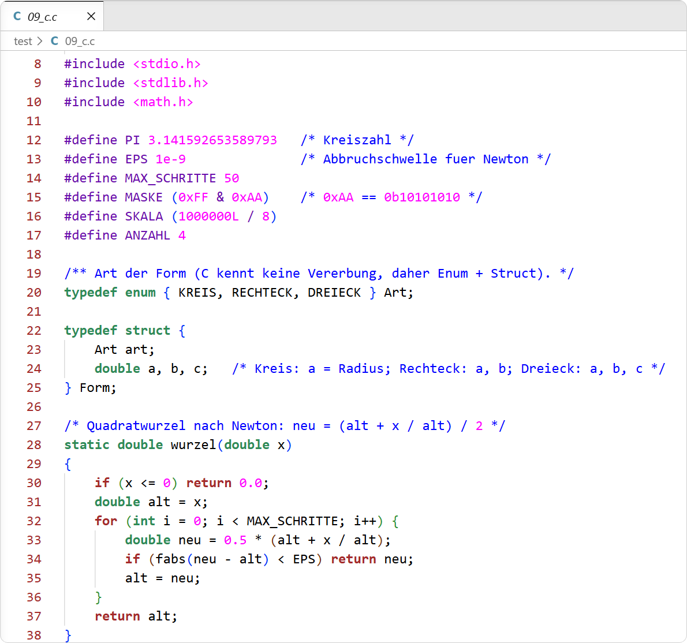
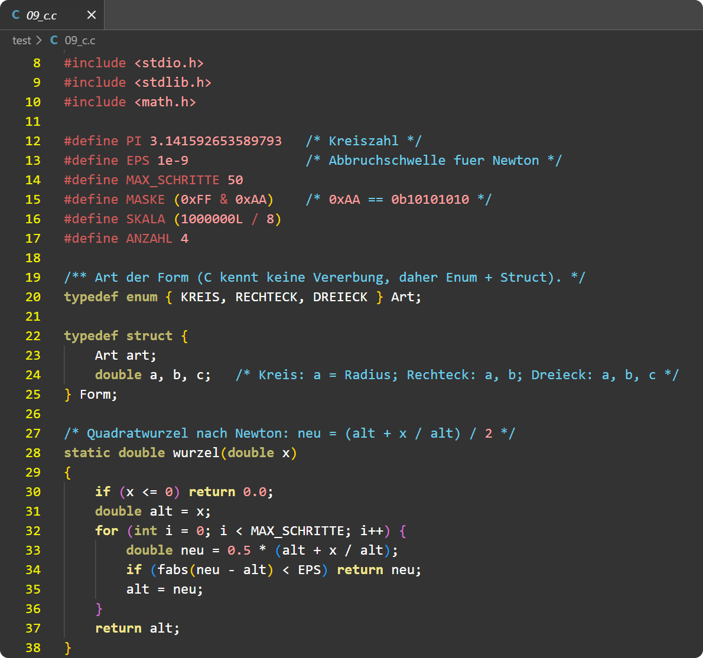

[Deutsch](README.de.md)

# VimSem

The color schemes of Vim 9.2 as themes for VS Code and VSCodium. They are called
**"VimSem desert"**, **"VimSem elflord"** and so on (34 themes). Select one via
*Preferences: Color Theme*.

The colors come from Vim's color schemes, and the code is colored with Vim's own syntax rules.
The goal is that a file looks the way gVim shows it with its default settings (no vimrc, no
plugins). **Vim does not need to be installed.**





## Requirement: semantic highlighting

VimSem colors code with semantic highlighting. If your `settings.json` contains this line,
**remove it**, otherwise the syntax colors do not appear:

```json
"editor.semanticHighlighting.enabled": false
```

The extension "Vim Colorschemes" recommends this setting. If you added it for that extension,
remove it when you switch to VimSem.

## Themes

blue, catppuccin*, darkblue, default, delek, desert, elflord, evening, habamax, industry,
koehler, lunaperche*, morning, murphy, novum*, pablo, peachpuff, quiet*, retrobox*, ron,
shine, slate, sorbet, torte, unokai, wildcharm*, zaibatsu, zellner

\* in light and dark

## Languages

ABAP, Ada, Arduino, Assembly, AutoHotkey, AWK, BASIC, Batch, BibTeX, C, C#, C++, Clojure,
COBOL, CSS, CUDA, Cython, D, Dart, Diff, Dockerfile, Elm, Erlang, Forth, GDScript, GLSL, Go,
Groovy, Haskell, HTML, INI, Java, JavaScript, JSON, JSON with comments, JSX, Julia, Kotlin,
LaTeX, Less, Lisp, Lua, Makefile, Markdown, MATLAB, Mojo, Nix, Nushell, Objective-C, OCaml,
Pascal, Perl, PHP, Plain TeX, PowerShell, Progress, Prolog, Python, R, Racket, Raku, Ruby,
Rust, SAS, Scala, Scheme, Scilab, SCSS, Shell (sh, bash, ksh), Smalltalk, Solidity, SQL,
Standard ML, Stata, Swift, SystemVerilog, Tcl, TOML, TSX, TypeScript, UnrealScript, Verilog,
VHDL, Visual Basic, XML, YAML, Zig

No language extensions are needed for the colors. As in Vim, the file name and sometimes the
content decide which rules apply.

**Other files are shown without syntax colors** while a VimSem theme is active, for example
Vue, Svelte, Fortran, Vim script, zsh, csh, ConTeXt, Sass (`.sass`), SVG, XSD, XSLT, JSON5 and
configuration files such as `.gitconfig`, `.editorconfig`, `*.cfg` or `*.conf`. Some
`*.conf` and similar files are recognized as INI or TOML, as in Vim.

Patches made with `git format-patch` are a file type of their own in Vim and are not colored
either.

## User interface

In the editor the colors come from Vim's color schemes: code, text and background, line
numbers, cursor line, cursor, selection and search matches.

Vim has nothing like the side bar, tabs or status bar of VS Code. Each theme derives these
colors from its own Vim colors.

## Closer to Vim (optional)

VimSem does not change any of your settings. To get closer to Vim, you can add these to your
`settings.json`:

```json
"editor.bracketPairColorization.enabled": false,
"editor.occurrencesHighlight": "off",
"editor.selectionHighlight": false,
"editor.renderLineHighlight": "none"
```

They stop VS Code from coloring brackets by depth, marking other occurrences of the word under
the cursor or of the selected text, and highlighting the current line. They apply to all
themes.

If you use `set cursorline` in Vim, leave out the last line: the themes already have Vim's
color for the current line. You can change it with `editor.lineHighlightBackground` in
`workbench.colorCustomizations`.

## Settings

| Setting | Default | Meaning |
|---|---|---|
| `vimsem.backgroundGroups` | `["Todo", "Error", "Constant"]` | Vim highlight groups whose background color is shown |
| `vimsem.logFile` | `false` | Also write the log to `protokoll.txt` in the extension folder |

## How close to Vim?

Syntax colors follow Vim closely: the [sample files in the repository](test/README.md) match
character by character in all 34 themes. Other code can differ in places.

## Limitations

- Where Vim has no usable color, for example for the selection in elflord, VS Code's own color
  is used. Bold line numbers cannot be shown.
- After each change the whole file is colored again, so very large files react slower.
- Another extension that provides semantic highlighting for the same language may take
  precedence.
- HTML templates (for example Django or Angular) are colored as plain HTML.
- As in Vim, comments in a `.json` file (for example `.vscode/settings.json`) are shown as
  errors. `tsconfig.json` and the user settings of VS Code and VSCodium are treated as JSON
  with comments.
- COBOL is colored for the fixed format only, as in Vim.
- As in Vim, the content decides whether a `.tex` file is LaTeX or Plain TeX. It is LaTeX if a
  line begins with `\documentclass`, `\usepackage`, `\begin{`, `\newcommand` or `\renewcommand`
  (about the first 1000 lines are searched). A chapter file with only `\section` and text is
  therefore treated as Plain TeX, which has much simpler colors. A first line `%&latex` makes it
  LaTeX. The Vim setting `g:tex_flavor` is not read.

## Feedback

Found a difference from Vim, or missing a language? Please open an
[issue](https://github.com/r11s/vim-semantic/issues) with the language, the theme and a short
example. A language can only be added if Vim has syntax highlighting for it.

## License and origin

VimSem is distributed under the Vim license, see [LICENSE](LICENSE). Themes, syntax data and
file type detection are derived from files of [Vim](https://github.com/vim/vim) and have been
modified. Details for each file are in [LIZENZEN.md](LIZENZEN.md) (in German).

Author and license of the color schemes, as given in the header lines of the Vim files:

| Scheme | Author | License according to file |
| --- | --- | --- |
| blue | Steven Vertigan | same as Vim |
| catppuccin | The Catppuccin Community (maintained by Mao-Yining) | not stated in the file |
| darkblue | Bohdan Vlasyuk | same as Vim |
| default | The Vim Project (formerly Bram Moolenaar) | not stated in the file |
| delek | David Schweikert | same as Vim |
| desert | Hans Fugal | same as Vim |
| elflord | Ron Aaron | same as Vim |
| evening | Bram Moolenaar (maintained by Steven Vertigan) | same as Vim |
| habamax | Maxim Kim | same as Vim |
| industry | Shian Lee | same as Vim |
| koehler | Ron Aaron | same as Vim |
| lunaperche | Maxim Kim | not stated in the file |
| morning | Bram Moolenaar | same as Vim |
| murphy | Ron Aaron | same as Vim |
| novum | Charan Mandati | Vim License |
| pablo | Ron Aaron | same as Vim |
| peachpuff | David Nečas (Yeti) | same as Vim |
| quiet | Maxence Weynans | Vim License |
| retrobox | Maxim Kim, ported from gruvbox8 (Lifepillar); gruvbox by morhetz | not stated in the file |
| ron | Ron Aaron | same as Vim |
| shine | Yasuhiro Matsumoto | same as Vim |
| slate | Ralph Amissah | same as Vim |
| sorbet | Maxence Weynans | Vim License |
| torte | Thorsten Maerz | same as Vim |
| unokai | k-37, similar to Monokai by Wimer Hazenberg | not stated in the file |
| wildcharm | Maxim Kim | same as Vim |
| zaibatsu | Romain Lafourcade | same as Vim |
| zellner | Ron Aaron | same as Vim |

Where it says "not stated in the file", the header does not name a license.

## Releases

- **1.0.1**: New README with preview images of VimSem default and desert, and a German
  version on GitHub.
- **1.0.0**: First release with 34 themes for 87 languages and formats.
